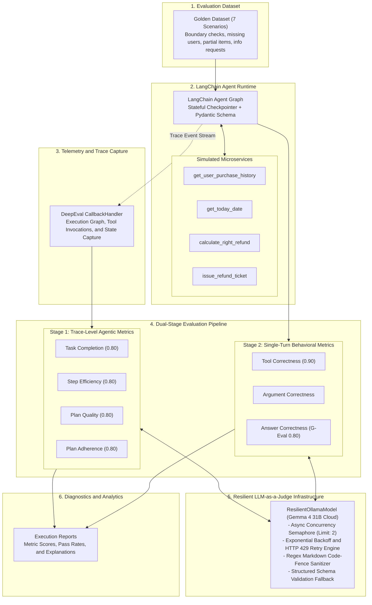

# LangChain Agent Evaluation System
## Full-Lifecycle Observability, Trace Evaluation, and Deterministic Benchmarking for Autonomous AI Agents

[](https://www.python.org/)
[](https://www.langchain.com/)
[](https://github.com/confident-ai/deepeval)
[](https://ollama.com/)
[](https://github.com/astral-sh/uv)
[](LICENSE)

---

## Executive Summary

Autonomous tool-calling agents deployed in production environments present failure modes distinct from standard retrieval-augmented generation (RAG) or single-turn language models. An agent can produce a syntactically valid and polite natural language response while simultaneously failing business-critical requirements: hallucinating tool parameters, executing superfluous operations, mismanaging state across steps, or violating organizational governance policies (such as refunding unauthorized or expired transactions).

I built this repository as an end-to-end evaluation and observability system for tool-using agents. The project couples a stateful customer refund agent with an automated testing pipeline that executes across **7 deterministic golden scenarios** and evaluates behavior using **7 discrete DeepEval metrics**.

The architecture captures complete execution graphs via LangChain runtime callbacks, analyzes both intermediate trajectory traces and terminal outputs, and integrates a custom **Resilient LLM-as-a-Judge execution harness** engineered to handle concurrency limits, exponential backoff, and structured schema extraction against cloud and local endpoints.


*Figure 1: DeepEval trace evaluation report capturing intermediate agentic metrics including Task Completion, Step Efficiency, Plan Quality, and Plan Adherence.*

---

## Architecture and System Design

The framework enforces strict decoupling between agent runtime execution and the evaluation pipeline.



---

## Evaluation Metrics

Every scenario is evaluated across seven distinct metrics across two operational categories:

| Metric | Category | Implementation | Evaluation Target | Threshold |
|---|---|---|---|:---:|
| **Task Completion** | Agentic Trace | `TaskCompletionMetric` | Validates whether the agent fulfilled the policy requirements without violating operational constraints. | `0.80` |
| **Step Efficiency** | Agentic Trace | `StepEfficiencyMetric` | Identifies redundant or unnecessary tool calls (e.g., executing price calculations on expired orders). | `0.80` |
| **Plan Quality** | Agentic Trace | `PlanQualityMetric` | Evaluates whether the plan formulated by the agent is logically sound and sufficient for the task. | `0.80` |
| **Plan Adherence** | Agentic Trace | `PlanAdherenceMetric` | Measures whether the agent strictly adhered to its stated plan during tool execution. | `0.80` |
| **Tool Correctness** | Component Output | `ToolCorrectnessMetric` | Confirms that all expected tools were invoked without missing or extraneous calls. | `0.90` |
| **Argument Correctness** | Component Output | `ArgumentCorrectnessMetric` | Audits the validity and appropriateness of parameters passed into tool calls against user input. | `0.80` |
| **Answer Correctness** | Component Output | `GEval` (Rubric-based) | Measures logical conclusion alignment between actual agent response and reference goldens. | `0.80` |


*Figure 2: Aggregate metric evaluation summary displaying Tool Correctness, Argument Correctness, and Answer Correctness.*

---

## Technical Challenges and Engineering Solutions

Evaluating non-deterministic agents against external or local LLM instances exposes several systems-level challenges:

### 1. Concurrency Management and HTTP 429 Mitigation
* **Problem:** DeepEval schedules asynchronous evaluations concurrently (`max_concurrent=20` by default). Cloud LLM providers and proxied model gateways (such as Ollama Cloud) enforce strict concurrency quotas, immediately returning HTTP 429 (`too many concurrent requests`). DeepEval's internal Ollama retry policy assumes zero rate limiting and fails immediately upon encountering HTTP 429.
* **Solution:** I implemented `ResilientOllamaModel` in [`evaluations/model.py`](evaluations/model.py). The class wraps execution in an `asyncio.Semaphore(2)` concurrency governor, introduces an exponential backoff retry loop (8 attempts, base delay 2.0s with geometric scaling), and incorporates throttled batch execution via `AsyncConfig(throttle_value=1.0)`.

### 2. Markdown Code-Fence Sanitization for Structured Outputs
* **Problem:** DeepEval relies on Pydantic's `model_validate_json()` to parse structured reasoning steps during metric evaluation. Open-weight instruction-tuned models frequently wrap JSON outputs within Markdown code blocks (` ```json ... ``` `), triggering `pydantic_core.ValidationError: Invalid JSON`.
* **Solution:** Added an automated regex pre-processing step (`_strip_code_fence`) that intercepts LLM output strings, strips Markdown fences, and extracts the raw JSON payload before validation. If initial parsing fails, a programmatic schema-guided re-prompt mechanism is triggered.

### 3. Stateful Graph Invocation and Structured Response Guarantees
* **Problem:** During boundary-case queries (such as unregistered users), tool-calling models can output standard chat messages while bypassing the structured `Answer` tool call, causing `NoneType` attribute errors during downstream evaluation.
* **Solution:** Implemented `_guaranteed_invoke` in [`agent/agent.py`](agent/agent.py). This wrapper automatically provisions isolated conversation thread IDs for session state separation and inspects message trajectories to safely construct a valid `Answer` schema when structured tool calls are omitted.


*Figure 3: Detailed test case diagnostic showing per-step reasoning and parameter validation on edge cases.*

---

## Empirical Benchmark Results

Evaluation conducted against the complete 7-scenario golden test suite using `gemma4:31b-cloud`:

```
===============================================================================
                       DEEPEVAL AGENT EVALUATION BENCHMARK
===============================================================================

Evaluation completed successfully.
Test Cases Evaluated: 7
Overall Pass Rate: 85.71% (6 Passed, 1 Failed)

-------------------------------------------------------------------------------
Metric Breakdown:
  - Tool Correctness:     1.00 score | 100.00% pass rate (7/7 passed)
  - Task Completion:      0.94 score |  85.71% pass rate (6/7 passed)
  - Answer Correctness:   0.86 score |  85.71% pass rate (6/7 passed)
  - Step Efficiency:      0.88 score |  85.71% pass rate (6/7 passed)
  - Plan Adherence:       0.92 score |  85.71% pass rate (6/7 passed)
  - Plan Quality:         1.00 score | 100.00% pass rate (7/7 passed)
-------------------------------------------------------------------------------
```


*Figure 4: Detailed metric diagnostics illustrating step efficiency analysis and tool selection validation.*

### Failure Case Analysis
On scenario `test_case_6` (refund requested on an item purchased over 30 days prior), the agent reached the correct business decision (refusing the refund ticket). However, the Step Efficiency metric flagged an unnecessary tool invocation: the agent queried item pricing before validating the purchase timestamp. This diagnostic identified a specific prompt optimization target: *requiring date verification as a strict prerequisite before invoking pricing calculations.*

---

## Repository Structure

```
Agent_Eval/
├── agent/                         # Core LangChain Agent implementation
│   ├── agent.py                   # Graph instantiation, checkpointer, and invocation wrapper
│   ├── data.py                    # Mock customer database (10 records, purchase histories)
│   ├── models.py                  # LangChain ChatOllama model configuration
│   ├── objects.py                 # Pydantic schemas (Answer, PurchaseItem)
│   ├── prompts.py                 # System prompt defining business governance rules
│   ├── streamlit_ui.py            # Streamlit interactive UI playground
│   └── tools.py                   # 4 LangChain tools (lookup, date, pricing, ticketing)
│
├── evaluations/                   # DeepEval Evaluation Suite
│   ├── eval_all.py                # Dual-stage 7-metric evaluation runner
│   ├── model.py                   # ResilientOllamaModel with concurrency and retry logic
│   ├── dataset.py                 # 7 golden scenarios with expected outputs and tool calls
│   ├── task_completion.py         # Standalone Task Completion evaluator
│   ├── tool_correctness.py        # Standalone Tool Correctness evaluator
│   ├── answer_correctness.py      # Standalone Answer Correctness (G-Eval) evaluator
│   ├── argument_correctness.py    # Standalone Argument Correctness evaluator
│   ├── step_efficiency.py         # Standalone Step Efficiency evaluator
│   ├── plan_quality.py            # Standalone Plan Quality evaluator
│   └── plan_adherence.py          # Standalone Plan Adherence evaluator
│
├── understanding_metrics/         # Isolated reference implementations for each metric
├── screenshots/                   # Terminal evaluation outputs and metric evidence
├── pyproject.toml                 # Package definition and locked dependencies
├── .env.example                   # Environment variable template
└── README.md                      # Architectural and technical documentation
```

---

## Getting Started

### Prerequisites
* Python 3.12+
* [uv](https://github.com/astral-sh/uv) (Fast Python package installer and resolver)
* Local [Ollama](https://ollama.com/) daemon running:
  ```bash
  ollama run gemma4:31b-cloud
  ```

### 1. Installation
Clone the repository and synchronize the locked dependencies:
```bash
git clone https://github.com/avish006/Agent_Eval.git
cd Agent_Eval
uv sync
```

### 2. Environment Configuration
Copy the template configuration:
```bash
cp .env.example .env
```
Default configuration connects to the local Ollama daemon on port 11434:
```dotenv
OLLAMA_MODEL="gemma4:31b-cloud"
OLLAMA_BASE_URL="http://localhost:11434"
```

### 3. Run the Complete 7-Metric Evaluation Suite
```bash
uv run python evaluations/eval_all.py
```

### 4. Run Individual Metric Benchmarks
```bash
# Evaluate tool selection accuracy
uv run python evaluations/tool_correctness.py

# Evaluate task completion
uv run python evaluations/task_completion.py

# Evaluate answer correctness with G-Eval
uv run python evaluations/answer_correctness.py
```

### 5. Run the Interactive Agent CLI
```bash
uv run python agent/agent.py
```

---

## Author

**Avish**  
AI / LLM Systems Engineer  
* GitHub: [@avish006](https://github.com/avish006)  
* Email: avishcoder@gmail.com  

---

## License

This project is licensed under the MIT License. See the [LICENSE](LICENSE) file for details.
