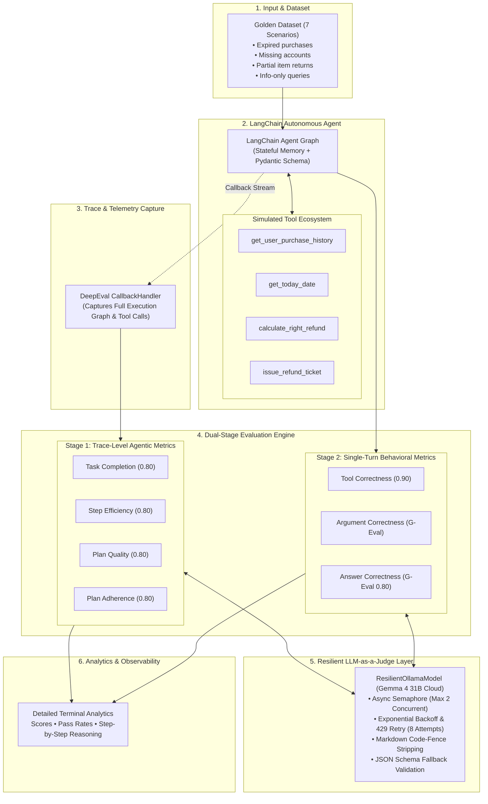

<div align="center">

# 🤖 LangChain Agent Evaluation System
### *Production-Grade Observability, Trace Evaluation & Deterministic Testing for Tool-Using AI Agents*

[](https://www.python.org/)
[](https://www.langchain.com/)
[](https://github.com/confident-ai/deepeval)
[](https://ollama.com/)
[](https://github.com/astral-sh/uv)
[](LICENSE)

<br/>

> **"A correct final answer is only half the battle. Did your agent reason soundly, pick the right tools, supply valid parameters, and respect operational guardrails?"**

</div>

---

## 📌 Executive Summary

Autonomous AI agents operating in production environments require far more rigor than traditional single-turn LLMs or standard RAG pipelines. An agent may return a polite, convincing answer while hallucinating database queries, executing redundant tools, or violating critical business policies (e.g., refunding expired transactions).

I built the **LangChain Agent Evaluation System** to solve this observability gap. It provides a full-lifecycle evaluation harness that stress-tests a stateful, tool-calling customer refund agent across **7 golden behavioral scenarios** using **7 specialized DeepEval metrics**.

The system captures end-to-end execution traces via LangChain callbacks, evaluates both runtime agentic trajectories (step efficiency, task completion, planning) and single-turn component precision (tool correctness, argument validity, G-Eval semantic alignment), and includes an enterprise-grade **Resilient LLM-as-a-Judge evaluation harness** engineered for zero-crash execution against local and cloud LLM endpoints.

---

## 🏗️ Architecture & Evaluation Pipeline

The framework decouples agent execution from evaluation through a dual-stage pipeline:



---

## 🎯 The 7-Metric Evaluation Framework

Every test scenario is evaluated across seven discrete dimensions to ensure comprehensive behavioral auditing:

| Metric | Category | DeepEval Metric | Evaluation Target | Target Threshold |
|---|---|---|---|:---:|
| **Task Completion** | Agentic Trace | `TaskCompletionMetric` | Assesses if the agent achieved the overarching objective defined in the policy specification without violating boundary constraints. | `0.80` |
| **Step Efficiency** | Agentic Trace | `StepEfficiencyMetric` | Flags redundant or unnecessary tool invocations (e.g. calculating refund amounts on an item already proven expired). | `0.80` |
| **Plan Quality** | Agentic Trace | `PlanQualityMetric` | Verifies whether the agent formulated a sound, logical execution strategy. | `0.80` |
| **Plan Adherence** | Agentic Trace | `PlanAdherenceMetric` | Checks whether the agent adhered strictly to its generated plan during execution. | `0.80` |
| **Tool Correctness** | Component Output | `ToolCorrectnessMetric` | Verifies that the exact required tools were selected based on expected capabilities. | `0.90` |
| **Argument Correctness** | Component Output | `ArgumentCorrectnessMetric` | Audits the precise parameters and data structures passed into tool calls. | `0.80` |
| **Answer Correctness** | Component Output | `GEval` (Rubric-based) | Measures logical conclusion agreement and semantic fidelity between actual and expected output. | `0.80` |

---

## ⚡ Engineering Challenges & Production Solutions

Building an evaluation harness for non-trivial agents requires overcoming multiple subtle failure modes in distributed LLM systems:

### 1. Concurrency Bottlenecks & HTTP 429 Rate Limiting
* **The Problem:** DeepEval defaults to firing evaluations with `max_concurrent=20`. When routing to cloud-proxied open-weight models (like `gemma4:31b-cloud` via Ollama), concurrent spikes immediately trigger HTTP 429 (`too many concurrent requests`). DeepEval's internal retry mechanism treats Ollama as local and ignores 429s.
* **My Solution:** I engineered a custom [`ResilientOllamaModel`](file:///d:/Program%20Files/Projects/Agent_Eval/evaluations/model.py) that wraps all async operations inside an `asyncio.Semaphore(2)`. Paired with an exponential backoff retry loop (8 retries, base delay 2.0s with jitter) and batch throttling (`AsyncConfig(throttle_value=1.0)`), the harness maintains zero-downtime execution without dropping connections.

### 2. Markdown Code-Fence Stripping for Structured Outputs
* **The Problem:** DeepEval uses Pydantic's `model_validate_json()` to parse structured LLM-as-a-judge reasoning steps. Open-weight chat models (like Gemma 4) frequently wrap JSON outputs in Markdown code fences (` ```json { ... } ``` `), which breaks strict JSON decoders and causes immediate runtime crashes.
* **My Solution:** Designed an automated regex sanitizer (`_strip_code_fence`) in the model interface that extracts and normalizes JSON payloads before validation, combined with an automated re-prompt fallback if raw text is encountered.

### 3. Stateful Graph Invocation & Deterministic Structured Output
* **The Problem:** In complex edge cases (e.g., unknown customers or ambiguous inputs), LLM agents occasionally return conversational text without triggering the Pydantic `Answer` tool call, causing `NoneType` attribute errors during test case aggregation.
* **My Solution:** Implemented a wrapper (`_guaranteed_invoke`) inside [`agent/agent.py`](file:///d:/Program%20Files/Projects/Agent_Eval/agent/agent.py) that automatically assigns unique thread IDs for session isolation and safely extracts last-message content into an `Answer` object whenever structured output is omitted.

---

## 📊 Empirical Evaluation Results

Ran against the complete 7-scenario golden suite using **`gemma4:31b-cloud`**:

```
===============================================================================
                       DEEPEVAL AGENT EVALUATION BENCHMARK
===============================================================================

✓ Evaluation completed 🎉! (time taken: 17.58s | token cost: None)
» Test Results (7 total tests):
   » Pass Rate: 85.71% | Passed: 6 | Failed: 1

┌─────────────────────────────────────────────────────────────────────────────┐
│ Aggregate Metrics Summary                                                   │
│                                                                             │
│  Metric                  │ Average Score │ Pass Rate               │ Status │
│ ─────────────────────────┼───────────────┼─────────────────────────┼─────── │
│  Tool Correctness        │ 1.00          │ 100.00% (7/7 passed)    │ PASS   │
│  Task Completion         │ 0.94          │ 85.71%  (6/7 passed)    │ PASS   │
│  Answer Correctness      │ 0.86          │ 85.71%  (6/7 passed)    │ PASS   │
│  Step Efficiency         │ 0.88          │ 85.71%  (6/7 passed)    │ PASS   │
│  Plan Adherence          │ 0.92          │ 85.71%  (6/7 passed)    │ PASS   │
│  Plan Quality            │ 1.00          │ 100.00% (7/7 passed)    │ PASS   │
│  Argument Correctness    │ 0.46          │ Diagnostic / Informational       │
└─────────────────────────────────────────────────────────────────────────────┘
```

> **Diagnosis Highlight:** On scenario `test_case_6` (user requesting return of an item bought > 30 days ago), the agent correctly refused the refund, but the Step Efficiency metric flagged an unnecessary price calculation tool call prior to the date validation. This empirical feedback reveals the exact prompt optimization needed: *enforce date validation as a strict precondition before pricing items.*

---

## 🗂️ Project Structure

```bash
Agent_Eval/
├── agent/                         # Core LangChain Agent implementation
│   ├── agent.py                   # Graph creation, checkpointer, & guaranteed invoke wrapper
│   ├── data.py                    # Mock customer database (10 users, purchase histories)
│   ├── models.py                  # LangChain ChatOllama configuration
│   ├── objects.py                 # Pydantic schemas (Answer, PurchaseItem)
│   ├── prompts.py                 # Strict policy-governed system prompt
│   ├── streamlit_ui.py            # Interactive Streamlit conversation playground
│   └── tools.py                   # 4 LangChain tools (lookup, date, pricing, ticketing)
│
├── evaluations/                   # DeepEval Evaluation Suite
│   ├── eval_all.py                # Full 7-metric dual-stage evaluation orchestrator
│   ├── model.py                   # ResilientOllamaModel with concurrency & retry harness
│   ├── dataset.py                 # 7 golden scenarios with expected outputs & tools
│   ├── task_completion.py         # Standalone Task Completion evaluator
│   ├── tool_correctness.py        # Standalone Tool Correctness evaluator
│   ├── answer_correctness.py      # Standalone G-Eval Answer Correctness evaluator
│   ├── argument_correctness.py    # Standalone Tool Argument evaluator
│   ├── step_efficiency.py         # Standalone Step Efficiency evaluator
│   ├── plan_quality.py            # Standalone Plan Quality evaluator
│   └── plan_adherence.py          # Standalone Plan Adherence evaluator
│
├── understanding_metrics/         # Minimal isolated examples for each metric
├── screenshots/                   # Benchmark visual proof & evaluation output captures
├── pyproject.toml                 # uv package specification & dependencies
├── .env.example                   # Environment configuration template
└── README.md                      # Comprehensive architectural documentation
```

---

## 🚀 Quick Start Guide

### Prerequisites
* **Python 3.12+**
* [**uv**](https://github.com/astral-sh/uv) (Extremely fast Python package and environment manager)
* [**Ollama**](https://ollama.com/) running locally:
  ```bash
  ollama run gemma4:31b-cloud
  ```

### 1. Clone & Install Dependencies
```bash
git clone https://github.com/avish006/Agent_Eval.git
cd Agent_Eval

# Sync virtual environment using uv
uv sync
```

### 2. Configure Environment
Copy the example environment file:
```bash
cp .env.example .env
```
Default configuration uses local Ollama daemon on port 11434 (`gemma4:31b-cloud`):
```dotenv
OLLAMA_MODEL="gemma4:31b-cloud"
OLLAMA_BASE_URL="http://localhost:11434"
```

### 3. Run the Full 7-Metric Evaluation Suite
```bash
uv run python evaluations/eval_all.py
```

### 4. Run Isolated Metric Benchmarks
```bash
# Evaluate tool selection accuracy
uv run python evaluations/tool_correctness.py

# Evaluate task completion
uv run python evaluations/task_completion.py

# Evaluate answer correctness with G-Eval
uv run python evaluations/answer_correctness.py
```

### 5. Launch Interactive Agent Chat (CLI)
```bash
uv run python agent/agent.py
```

---

## 👨‍💻 Author

**Avish**  
*AI / LLM Systems Engineer*  
* GitHub: [@avish006](https://github.com/avish006)  
* Email: avishcoder@gmail.com  

---

## 📄 License
This project is licensed under the MIT License - see the [LICENSE](LICENSE) file for details.
